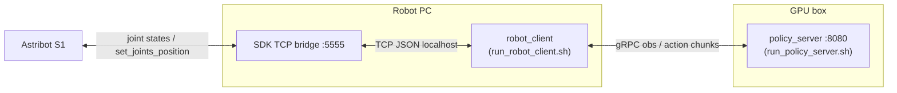

# Astribot VLA Inference

Closed-loop inference on the real robot: a **policy server** on the GPU box and a
LeRobot **robot client** next to the SDK on the robot PC. The arm never talks to
the GPU.



Scripts: [`examples/astribot/`](examples/astribot/).

---

## 1. Concepts

### 1.1 The control loop (async chunks)

1. The robot PC sends **observations** at ~30 Hz: 16-D joint state + 3 JPEG cameras.
2. The client forwards them to the policy server (gRPC), with the current **task** string.
3. The model predicts a **50-step action chunk** (`action_horizon=50`, trained at 30 Hz).
4. The client executes the chunk at 30 Hz while the server is already computing the next
   one (`chunk_size_threshold`, default 0.5). Unused steps are not discarded as a single
   `EXECUTE_INDEX` pick — that was the old sync client.

The SDK bridge must **stream**: apply the latest action at 30 Hz and send fresh obs
without waiting for motion-done. A one-obs-one-action RPC cannot drain a 50-step chunk.

### 1.2 Joint layouts — the #1 source of bugs

Two 16-D orderings exist in this system:

| layout | order | used by |
|---|---|---|
| **trailing** | `[L arm 7, R arm 7, gripper_left, gripper_right]` | training data (v186/v30), norm stats, policy |
| **interleaved** | `[L arm 7, gripper_left, R arm 7, gripper_right]` | robot wire (`arm_left, effector_left, arm_right, effector_right`) |

The `astribot` robot class remaps **both directions** (obs → policy, action → robot).
It knows the robot's layout two ways, in priority order:

1. **Auto-detect from names** — if the obs is
   `{"state": {"values": [...], "names": [...]}}` with ≥16 names, the client checks
   whether index 7 is gripper-like (`gripper`/`effector`/…). Log line:
   `Robot names say interleaved [L7,gL,R7,gR] — matching reply layout`.
2. **`qpos[7]` units** — if there are no names: value `> π` (gripper mm) → interleaved;
   negative (arm radian) → trailing.
3. **Flag** — `--robot.robot_interleaved=true|false` overrides. Default `auto` falls
   back to trailing when names and units are ambiguous.

Sanity check on any obs: `qpos[7]` in ~5–100 → interleaved (gripper mm); small radian
value (≈ −0.35) → trailing. Getting this wrong sends the **gripper command (0–100) to
`arm_right_j6` in radians** — always verify before powering the arm.

### 1.3 Units and the action space

- Arm joints: radians, absolute targets. Grippers: **0–100 mm, 0 = open, 100 = closed**,
  absolute. Never rescale 0–1 ↔ 0–100 on either side.
- The command sent to the robot is always **absolute** — the robot must not add `qpos`
  to it.
- New checkpoints trained with `--policy.use_relative_actions=true` still emit absolute
  joints after the server postprocessor. Clients send raw units.

### 1.4 Norm stats

Per-dim `mean/std/q01/q99` for `state` and `actions`, computed from the training
episodes. The policy server normalizes inputs and denormalizes outputs with the stats
stored **inside the checkpoint** — clients send raw units.

Do not serve a checkpoint with stats computed for a different action space.

### 1.5 Prompts / subtasks

π0.5 is conditioned on a per-frame subtask string.
[`examples/astribot/tasks.yaml`](examples/astribot/tasks.yaml) holds the 6 iced-coffee
subtasks (dataset `task_index` 0–5). While the client runs on a TTY: **1–6** jump,
**n/c** next, **p** previous. Every task-change log line shows the prompt hash + prefix;
changing the prompt drops the leftover action chunk so the next infer uses the new
instruction. If stdin is not a TTY, the hash never changes — run the client in a
real terminal.

Single-prompt mode: pass `--task="..."` and omit `--tasks_file`.

---

## 2. Prerequisites

- GPU box: this repo, a checkpoint with weights and processor/norm stats. LoRA adapters
  (`adapter_config.json`) are loaded automatically.
- Robot PC: SDK container with the TCP bridge, robot in Terminal mode / Power / Active /
  Home, cameras activated. LeRobot installed so `robot_client` can run.
- The robot PC can reach the GPU on `:8080`, **or** you SSH from the robot PC to the GPU
  with a local forward (the GPU box cannot need to reach the robot LAN).

---

## 3. Runbook

### Step 1 — GPU: start the policy server (keep running)

```bash
bash examples/astribot/run_policy_server.sh
# overrides: HOST=0.0.0.0 PORT=8080 FPS=30
```

The server is empty until the client handshake. `--pretrained_name_or_path` on the
client is resolved **on the GPU**.

### Step 2 — Robot PC: SDK bridge (streaming)

Keep the ROS1 SDK loop. Change the TCP side from one-obs-wait-for-action to:

- 30 Hz: `set_joints_position(..., control_way="filter")` with the **last** action.
- Read incoming actions **non-blocking**; apply the newest; drop backlog.
- Send a fresh obs at ~30 Hz; do **not** wait for motion-done.
- On TCP drop: **hold the last command**; never zero the joints.

Bind the bridge on `0.0.0.0:5555` (or localhost if the client is on the same box).

### Step 3 — Tunnel (only if needed)

If the robot LAN cannot open `gpu:8080`:

```bash
# on the robot PC
ssh -N -L 8080:127.0.0.1:8080 user@gpu-box
```

Then the client uses `--server_address=127.0.0.1:8080`. This **inverts** the old
`ssh -R 5555` setup (GPU used to reach the robot). Do not stack `-R 5555` on top of
this forward.

### Step 4 — Robot PC: start the VLA client

```bash
CKPT=/path/on/gpu/to/checkpoint \
TASK_INDEX=0 \
bash examples/astribot/run_robot_client.sh
```

Environment variables:

| var | default | meaning |
|---|---|---|
| `SERVER_ADDRESS` | `127.0.0.1:8080` | gRPC policy server (`host:port`) |
| `CKPT` | `./outputs/pi05_mem_astribot_lora/checkpoints/last/pretrained_model` | checkpoint path **on the GPU** |
| `TASKS_FILE` | `examples/astribot/tasks.yaml` | subtask list; empty = use `TASK` only |
| `TASK_INDEX` | `0` | initial subtask (0-based) |
| `TASK` | (empty) | single instruction if `TASKS_FILE` is unset |
| `POLICY_TYPE` | `pi05` | must match the checkpoint |
| `POLICY_DEVICE` | `cuda` | device the **server** loads onto |
| `ACTIONS_PER_CHUNK` | `50` | must not exceed the checkpoint chunk size |
| `FPS` | `30` | client control rate |
| `BRIDGE_HOST` / `BRIDGE_PORT` | `127.0.0.1` / `5555` | SDK TCP bridge |
| `ROBOT_INTERLEAVED` | `auto` | `true` / `false` to force wire layout |

---

## 4. Robot-side contract (bridge script)

Obs → client (4-byte big-endian length prefix + UTF-8 JSON), sent at ~30 Hz:

```json
{"type": "obs",
 "state": {"values": [16 floats], "names": [16 strings]},
 "images": {"head": "<b64 jpeg>", "left_wrist": "<b64>", "right_wrist": "<b64>"},
 "images_ok": true}
```

Client → robot (same framing), sent at 30 Hz as the chunk drains:

```json
{"type": "action", "layout": "interleaved",
 "values": [16 floats], "names": [16 strings],
 "action": {"values": [16], "names": [16]},
 "parts": {"astribot_arm_left": [7], "astribot_gripper_left": [1],
           "astribot_arm_right": [7], "astribot_gripper_right": [1]}}
```

Rules on the robot:

- Apply `action.values` in the **same positional order** you sent the obs
  (`arm_left, effector_left, arm_right, effector_right` when interleaved) — the reply
  layout echoes your obs layout. Cross-check with `names` if unsure.
- Clamp to `get_joints_position_limit`, reject non-finite, clip grippers to [0, 100].
- Keep calling `set_joints_position(..., control_way="filter")` at **30 Hz** with the
  last action — also when no new VLA packet has arrived. Calling it only on packet
  arrival triggers the SDK's "calling frequency does not match" warning and stalls
  motion.
- On VLA disconnect: **hold the last command**; never zero the joints.
- Do **not** wait until the command is done before the next obs. Async inference needs
  a continuous obs stream.

---

## 5. Verify it works (log checklist)

Client / server logs, in order:

1. Policy server: `PolicyServer started on 0.0.0.0:8080`.
2. Client: `Connected to policy server` then `Sending policy instructions`.
3. Server: `Receiving policy instructions ... Pretrained name or path: ...`
4. Client: `Robot names say interleaved …` (or trailing) — layout auto-detected.
5. Per infer on the server: preprocessing + inference time, action chunk shape
   `(50, 16)` (or your `ACTIONS_PER_CHUNK`).

Camera keys the policy sees: `observation.images.cam_head`,
`cam_left_wrist`, `cam_right_wrist`. Joint names (trailing):
`arm_left_j0..j6`, `arm_right_j0..j6`, `gripper_left`, `gripper_right`.

---

## 6. Troubleshooting

| symptom | cause / fix |
|---|---|
| `Cannot connect to Astribot bridge` | bridge not listening on 5555, or client `--robot.host/port` wrong. |
| `Timed out ... waiting for an obs` | bridge accepted but is not streaming `{"type":"obs",…}`. Enable the 30 Hz obs send; do not wait for motion-done. |
| `Failed to connect to policy server` | GPU server down, or tunnel missing. From the robot PC: `ssh -N -L 8080:127.0.0.1:8080 user@gpu`. |
| `Address already in use` on 8080 | another policy server (or an old `-L 8080`) is bound. |
| SDK warning `calling frequency of the set function…` | robot calls `set_joints_position` only on VLA packets. Keep a 30 Hz loop re-sending the last action. |
| `Bad qpos shape/values` | obs missing 16-D `state.values`/`qpos`. |
| left arm OK, right arm/grippers crazy | layout mismatch — see §1.2. Check `qpos[7]` units and the auto-detect log line. |
| motions tiny / robot barely moves | expected per-step arm deltas are ~0.01 rad at 30 Hz. Confirm the bridge does **not** wait for *done* between chunk steps. |
| `No pretrained model name found in adapter config` | LoRA folder is missing `adapter_config.json` / `base_model_name_or_path`. Serve the training run's adapter dir, not a stripped weights file. |
| changing prompt doesn't change the log hash | stdin is not a TTY (piped/scripted). Run the client in a real terminal and press 1–6. |

## 7. Safety

- Safe mode on the pendant first; know where the e-stop is.
- First real run: arm unloaded, workspace clear. Confirm layout auto-detect **before**
  enabling torque.
- The client never fabricates a zero command on disconnect. The robot side must hold
  the last command the same way.
